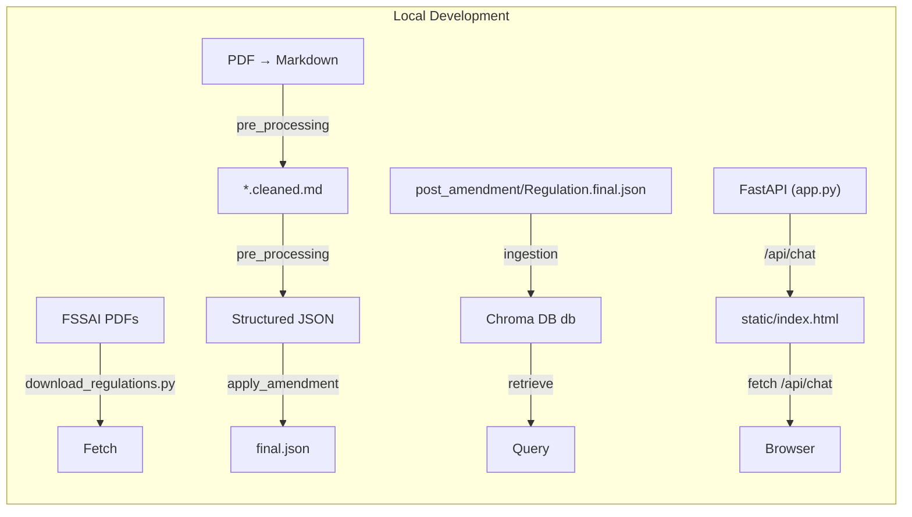
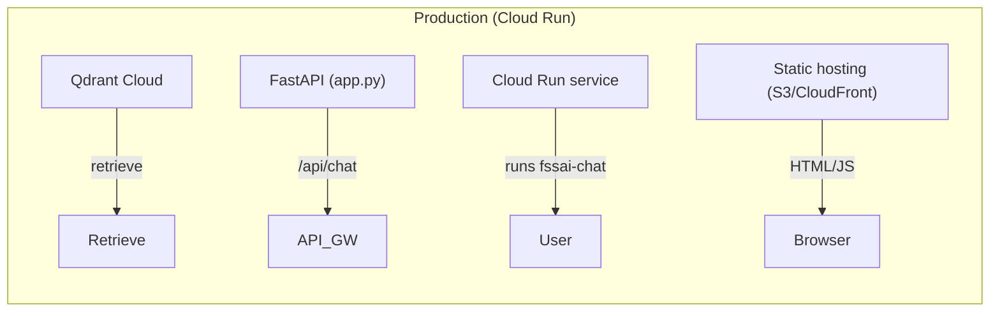
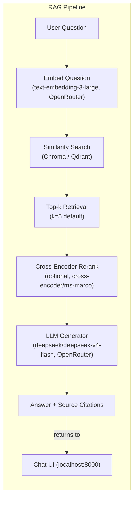

# FSSAI RAG

> **Status: WIP** — Work in progress. APIs, schema, and pipeline behavior may change without notice.

Tooling to download, convert, parse, and search Indian FSSAI food safety regulations and their amendments.

## Overview

The pipeline turns FSSAI regulation PDFs into structured JSON that can be fed into a RAG (retrieval-augmented generation) system:

1. **Download** — fetch regulation/amendment PDFs from FSSAI.
2. **Convert** — PDF → Markdown (`*.converted.md`).
3. **Clean** — strip gazette headers/footers (`*.cleaned.md`).
4. **Parse** — regulation Markdown → structured JSON (chapters/sections/sub-sections/schedules/forms) under `parsed/`.
5. **Amendments** — use an LLM to extract amendment changes (`date` + `changes`) from amendment notifications.
6. **Apply** — use an LLM to apply amendment changes onto the parsed regulation JSON, producing `regulation.final.json`.
7. **Ingest** — chunk the final regulation JSON, embed the chunks, and persist them to a Chroma vector store.

## Project layout

```
assets/regulations/          # downloaded PDFs + generated markdown/json (gitignored)
download_regulations.py      # fetch regulation PDFs
pre_processing/
  config.py                # preprocessing model and LLM settings
  cleanup_markdown.py        # PDF -> cleaned markdown
  regulation_parser.py       # regulation markdown -> structured JSON + pydantic DTOs
  amendment_parser.py        # amendment markdown -> amendment JSON (LLM)
  apply_amendment.py         # apply amendment JSON onto regulation JSON (LLM)
ingestion/
  config.py                # injectable chunking / embedding / chroma settings
  chunks_creator.py        # regulation JSON -> text chunks with metadata
  create_embeddings.py     # chunks -> embeddings (OpenRouter)
  persist_embeddings.py    # chunks + embeddings -> Chroma
utils/
  pdf_to_md.py               # PDF -> markdown conversion
  cleanup.py                 # remove generated artifacts
  generate_sample.py         # run the full sample pipeline
prompts/                     # LLM prompt templates
tests/                       # pytest unit tests
```

## Requirements

- Python 3.12 (managed with `uv`)
- An OpenRouter API key in a `.env` file (`OPENROUTER_API_KEY=...`) for the LLM-based preprocessing steps

## Quick start

```bash
uv sync
cp .env.example .env        # add your OPENROUTER_API_KEY
uv run pytest               # run unit tests (excludes integration)
uv run python utils/generate_sample.py                    # run all stages
uv run python utils/generate_sample.py --stages clean,parse   # run a subset
uv run python utils/generate_sample.py --force            # ignore incremental cache
```

## Architecture

### Local development



### Production / Cloud Run



### Data ingest path (both environments)
Same pipeline: PDF → cleaned markdown → parsed JSON → `post_amendment` → chunk/embed → vector store.
- **Local:** Chroma persists under `db/`
- **Production:** Chroma → Qdrant Cloud via `retrieval/sync_to_qdrant.py` then `app.py` defaults to Qdrant

### Key differences
| Aspect | Local | Production |
|---|---|---|
| Vector store | Chroma (ephemeral `db/`) | Qdrant Cloud (managed, persistent) |
| Chat server | `uvicorn app:app` locally | Cloud Run (auto-scaling, ~$0/mo demo) |
| Frontend | `static/index.html` served by FastAPI or static host | Hosted static site (S3/CloudFront/Cloudflare Pages) |
| API endpoint | `localhost:8000/api/chat` | Custom domain / API Gateway + Cloud Run |
| Qdrant URL/Key | Not required | Set `QDRANT_URL` / `QDRANT_API_KEY` env vars |

## RAG Pipeline

How a user question flows through the system, from retrieval to answer generation:

